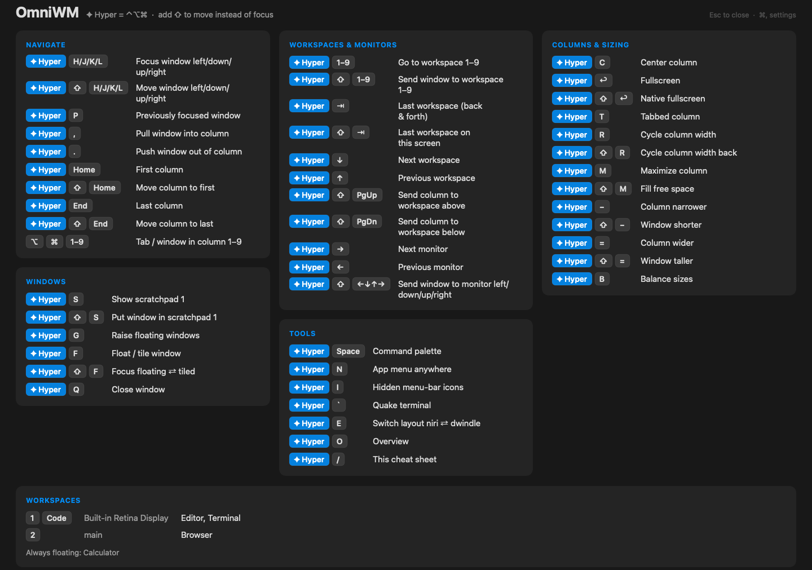

# OmniKeys

A floating cheat sheet for your [OmniWM](https://github.com/OmniNull/OmniWM) keyboard shortcuts.




OmniKeys reads your shortcuts from OmniWM's settings, so the sheet is always current.

## Install

There is no packaged release yet. Signed builds on [Releases](https://github.com/olujicz/omnikeys/releases) and a Homebrew cask are coming. Until then, [build from source](#build-from-source).

Requires macOS 14 or later and OmniWM.

## Use

Press ✦ Hyper + / to open the sheet. Hyper is the set of modifiers that OmniWM's Hyper key sends.

Esc, the same hotkey, or a click outside the sheet closes it. ⌘, opens Settings.

The menu-bar icon offers the same actions, plus Launch at Login. It also lists any problems with your settings.

Use Export Shortcuts… and Import Shortcuts… in the menu-bar menu to transfer assigned OmniWM shortcuts and Hyper key modifiers between Macs. Imports preserve workspaces and other OmniWM settings, and save a timestamped backup of the existing settings file first.

## Settings

Choose Settings… from the menu-bar icon, or press ⌘, while the sheet is open. Changes apply immediately.

Settings are stored in `~/.config/omnikeys/config.toml`, with every option documented inline. You can also edit the file directly (Open Settings File… in the menu); changes apply within a second, and Settings keeps your comments when it saves.

An older `~/.config/omniwm/omnikeys.toml` is moved there automatically.

## Troubleshooting

**The hotkey does nothing.** Another app owns it. The menu shows ⚠︎. Pick another hotkey in Settings.

**"OmniWM settings not found".** Open OmniWM once so it writes its settings.

**Logs.**

```sh
log stream --predicate 'subsystem == "rs.in.olujic.omnikeys"'
```

**Uninstall.** Quit OmniKeys, delete `OmniKeys.app`, and remove `~/.config/omnikeys` if you want your settings gone too.

## Build from source

You need Xcode 26 or later, [mise](https://mise.jdx.dev) and Homebrew.

```sh
make bootstrap     # install tools, generate the project
make run           # build and launch the debug app
make test          # run the tests
make install-dev   # install a Release build to ~/Applications
```

See [CONTRIBUTING.md](CONTRIBUTING.md) for more.

## License

[MIT](LICENSE)
